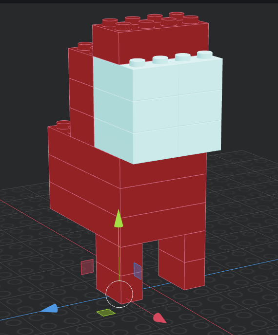

# Figura propia

La figura de Lego es inspirada en un personaje del videojuego Among Us.

</img>
</img>

## Parte 1: cuerpo con mochila

- 4x brick 1x2 red
- 3x brick 4x6 red
- 4x brick 2x4 red

## Parte 2: visor

- 6x brick 2x3 light blue

## Representación ASCII

```
   .----.
 .-|  |```|
|  |  ``|``
 \.|    |
   |_||_|
```
