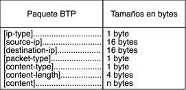

# Protocolo de comunicación BTP

## Tabla de contenidos

1. [Descripción general](#descripción-general)
1. [Forma de paquete](#forma-de-paquete)
1. [Descripción de atributos](#descripción-de-atributos)
   1. [ip-type](#ip-type)
   1. [source-ip](#source-ip)
   1. [destination-ip](#destination-ip)
   1. [packet-type](#packet-type)
   1. [content-type](#content-type)
   1. [content-length](#content-length)
   1. [content](#content)
1. [Interacción cliente e intermediario](#interacción-cliente-e-intermediario)
   1. [Cómo el cliente solicita el contenido del sistema de archivos](#cómo-el-cliente-solicita-el-contenido-del-sistema-de-archivos)
      1. [Alternativa 1: text/html/all-lego](#alternativa-1-texthtmlall-lego)
      1. [Alternativa 2: text/all-lego](#alternativa-2-textall-lego)
      1. [Alternativa 3: text/all-figures](#alternativa-3-textall-figures)
   1. [Cómo un cliente solicita una figura Lego en particular](#cómo-un-cliente-solicita-una-figura-lego-en-particular)
      1. [Alternativa 1: text/figure](#alternativa-1-textfigure)
      1. [Alternativa 2: text/lego](#alternativa-2-textlego)
1. [Interacción intermediario y servidor](#interacción-intermediario-y-servidor)
   1. [Cómo el intermediario solicita el contenido del sistema de archivos](#cómo-el-intermediario-solicita-el-contenido-del-sistema-de-archivos)
      1. [Alternativa 1: text/all-lego](#alternativa-1-textall-lego)
      1. [Alternativa 2: text/all-figures](#alternativa-2-textall-figures)
   1. [Cómo un intermediario solicita una figura Lego en particular](#cómo-un-intermediario-solicita-una-figura-lego-en-particular)
      1. [Alternativa 1: text/figure](#alternativa-1-textfigure-1)
      1. [Alternativa 2: text/lego](#alternativa-2-textlego-1)

## Descripción general

El protocolo BTP (_Basic Transfer Protocol_) es un protocolo diseñado para
enviar paquetes de texto a través de la red. Está compuesto por tres actores
principales: cliente, intermediario, y servidor. El cliente estará conectado a
un intermediario por medio de una conexión TCP. Luego, intermediarios podrán
enviar paquetes a otros intermediarios mediante un método que permita
realizar un _broadcast_ con UDP. Finalmente, el intermediario que consiga un
paquete, revisará si posee alguna conexión con la dirección destino. En
caso de no corresponder ninguna conexión con la dirección de destino,
descartará el paquete. En caso de que sí, remitirá el paquete a un servidor,
mediante TCP. Posterior a eso, se realizará el proceso inverso para remitir
un paquete de respuesta hacia la dirección que envió la petición inicial.

## Forma de paquete

La siguiente figura ilustra la forma en que un paquete BTP está conformado, por
orden exacto. Cabe destacar que las direcciones IP utilizadas pueden ser
IPv4 o IPv6.



## Descripción de atributos

### ip-type

Indica el tipo de dirección IP que tienen las direcciones del paquete.

- __IPv4__: equivale a 0x00
- __IPv6__: equivale a 0x01

### source-ip

Indica la dirección IPv4 o IPv6 del actor de la red que propició el paquete
en la red. Se envía la dirección IP convertida en formato de red.

### destination-ip

Indica la dirección IPv4 o IPv6 del actor de la red que deberá recibir el
paquete en la red. Se envía la dirección IP convertida en formato de red.

### packet-type

Se refiere al tipo de paquete:

- __STOP__: equivale a 0x00
- __REQUEST__: equivale a 0x01
- __RESPONSE__: equivale a 0x02
- __UNREACHABLE__: equivale a 0x03

### content-type

Se refiere al tipo de contenido enviado:

- __text/plain__: equivale a 0x01
- __text/html/all-lego__: equivale a 0x02
- __text/all-lego__: equivale a 0x03
- __text/lego__: equivale a 0x04
- __text/all-figures__: equivale a 0x05
- __text/figure__: equivale a 0x06

### content-length

Se refiere a la cantidad de _bytes_ que pesa el contenido enviado en el
paquete, el cual debe ser mayor o igual a 0. Debe ser un valor en el orden de
bytes de la red.

### content

Se refiere al contenido enviado por el paquete. Su extensión debe ser acorde al
atributo __content-length__.

## Interacción cliente e intermediario

La interacción del cliente e intermediario se basa en una conexión TCP entre
los dos actores. El intermediario funciona como un "servidor" desde la
perspectiva del cliente. Sin embargo, el intermediario solo se dedica a
redirigir paquetes petición a otros intermediarios o servidores, y paquetes
respuesta a clientes. Cuando un intermediario tiene un paquete de respuesta
proveniente de un servidor, este remite al cliente correspondiente.

Cuando un intermediario recibe un paquete con ```content-type: STOP```,
envía un paquete a sus conexiones para notificar a todos en la red que
deben desconectarse. Este tipo de comportamiento está enfocado para
simulaciones. Es opcional utilizarlo en una red de mayor escala. No debe de
remitir ningún paquete al cliente, porque el cliente ya estará desconectado
en el momento que el intermediario reciba este tipo de paquete.

Si un intermediario no puede encontrar ninguna conexión con una dirección igual
a ```destination-ip``` dentro de sus conexiones a servidores, remitirá
un paquete __UNREACHABLE__ vacío al cliente, con el siguiente formato:

| Paquete BTP | Valor |
| -------- | -------- |
| ip-type | IPv4 o IPv6 |
| source-ip | Dirección IP del intermediario |
| destination-ip | Dirección IP del cliente que solicitó el paquete |
| packet-type | UNREACHABLE |
| content-type | text/plain |
| content-length | /_tamaño variable_/ |
| content | /_la dirección IP del servidor inalcanzable como texto_/ |

### Cómo el cliente solicita el contenido del sistema de archivos

#### Alternativa 1: text/html/all-lego

Esta alternativa devuelve todos los legos que el destino tenga en su inventario
en formato HTML. No reduce la cantidad que tenga. Funciona para visualizar qué
hay en el inventario.

El cliente primero debe de establecer una conexión con algún intermediario.
Una vez establecida, el cliente envía un paquete con las siguientes
especificaciones:

| Paquete BTP | Valor |
| -------- | -------- |
| ip-type | IPv4 o IPv6 |
| source-ip | Dirección IP del cliente |
| destination-ip | Dirección IP del servidor destino |
| packet-type | REQUEST |
| content-type | text/html/all-lego |
| content-length | 0 |
| content | /_vacío_/ |

Posterior a eso, el cliente esperará por un paquete de respuesta. Cuando llegue
el paquete respuesta, tendrá la siguiente forma:

| Paquete BTP | Valor |
| -------- | -------- |
| ip-type | IPv4 o IPv6 |
| source-ip | Dirección IP del servidor |
| destination-ip | Dirección IP del cliente que solicitó el paquete |
| packet-type | RESPONSE |
| content-type | text/html/all-lego |
| content-length | /_tamaño variable_/ |
| content | /_contenido html_/ |

El contenido viene en formato HTML.

#### Alternativa 2: text/all-lego

Esta alternativa devuelve todos los legos que el destino tenga en su inventario.
No reduce la cantidad que tenga. Funciona para visualizar qué hay en el
inventario.

| Paquete BTP | Valor |
| -------- | -------- |
| ip-type | IPv4 o IPv6 |
| source-ip | Dirección IP del cliente |
| destination-ip | Dirección IP del servidor destino |
| packet-type | REQUEST |
| content-type | text/all-lego |
| content-length | 0 |
| content | /_vacío_/ |

Posterior a eso, el cliente esperará por un paquete de respuesta. Cuando llegue
el paquete respuesta, tendrá la siguiente forma:

| Paquete BTP | Valor |
| -------- | -------- |
| ip-type | IPv4 o IPv6 |
| source-ip | Dirección IP del servidor |
| destination-ip | Dirección IP del cliente que solicitó el paquete |
| packet-type | RESPONSE |
| content-type | text/all-lego |
| content-length | /_tamaño variable_/ |
| content | /_contenido_/ |

Formato del contenido:

```bash
"quantity":$,"description":"description text",
"quantity":$,"description":"description text",
...,
"quantity":$,"description":"description text"
```

El símbolo __$__ debe ser un número entero sin signo. Las etiquetas
__"quantity":__ y __"description":__ son siempre necesarias. En
caso de que el formato no sea correcto, el paquete deberá ser descartado.

En el caso de que se remitan muchas piezas Lego, el paquete deberá tener una
```,``` (coma) tras cada entrada.

#### Alternativa 3: text/all-figures

Esta alternativa devuelve el nombre de todas las figuras que se pueden crear
con legos. No devuelve ninguna pieza Lego, solo informa qué valores existen.

| Paquete BTP | Valor |
| -------- | -------- |
| ip-type | IPv4 o IPv6 |
| source-ip | Dirección IP del cliente |
| destination-ip | Dirección IP del servidor destino |
| packet-type | REQUEST |
| content-type | text/all-figures |
| content-length | 0 |
| content | /_vacío_/ |

Posterior a eso, el cliente esperará por un paquete de respuesta. Cuando llegue
el paquete respuesta, tendrá la siguiente forma:

| Paquete BTP | Valor |
| -------- | -------- |
| ip-type | IPv4 o IPv6 |
| source-ip | Dirección IP del servidor |
| destination-ip | Dirección IP del cliente que solicitó el paquete |
| packet-type | RESPONSE |
| content-type | text/all-figures |
| content-length | /_tamaño variable_/ |
| content | /_contenido_/ |

Formato del contenido:

```bash
"name&#","name&#",...,"name&#"
```

El símbolo ```name``` es reemplazada por el nombre de una figura Lego, el
símbolo ```&``` sirve para concatenar el siguiente símbolo. El símbolo ```#```
indica el número de parte. Por ejemplo, la parte 1 sería ```1```, la parte 2
sería ```2```, etc.

En caso de que el formato no sea correcto, el paquete deberá ser descartado.
En el caso de que se remitan muchas figuras Lego, el paquete deberá tener una
```,``` (coma) tras cada entrada.

### Cómo un cliente solicita una figura Lego en particular

#### Alternativa 1: text/figure

Esta alternativa devuelve todas las piezas Lego necesarias para formar una
figura específica, por ejemplo: "fish&1", "horse&2".
No reduce la cantidad de figuras que tenga el inventario. Funciona para
visualizar qué legos específicos conforman una pieza.

| Paquete BTP | Valor |
| -------- | -------- |
| ip-type | IPv4 o IPv6 |
| source-ip | Dirección IP del cliente |
| destination-ip | Dirección IP del servidor destino |
| packet-type | REQUEST |
| content-type | text/figure |
| content-length | /_tamaño variable_/ |
| content | /_nombre exacto de una figura_/ |

Ejemplo de contenido: ```fish&1```.

Posterior a eso, el cliente esperará por un paquete de respuesta. Cuando llegue
el paquete respuesta, tendrá la siguiente forma:

| Paquete BTP | Valor |
| -------- | -------- |
| ip-type | IPv4 o IPv6 |
| source-ip | Dirección IP del servidor |
| destination-ip | Dirección IP del cliente que solicitó el paquete |
| packet-type | RESPONSE |
| content-type | text/figure |
| content-length | /_tamaño variable_/ |
| content | /_contenido_/ |

Formato del contenido:

```bash
"quantity":$,"description":"description text",
"quantity":$,"description":"description text",
...,
"quantity":$,"description":"description text"
```

#### Alternativa 2: text/lego

Esta alternativa devuelve una pieza Lego específica del inventario. Se puede
pedir una cantidad arbitraria, siempre y cuando el inventario tenga esa
cantidad. En caso de que el inventario tenga menos piezas de las que se le
piden, enviará las que pueda. Y también deberá reducir su cantidad de piezas
actuales de su inventario.

| Paquete BTP | Valor |
| -------- | -------- |
| ip-type | IPv4 o IPv6 |
| source-ip | Dirección IP del cliente |
| destination-ip | Dirección IP del servidor destino |
| packet-type | REQUEST |
| content-type | text/lego |
| content-length | /_número de bytes del contenido_/ |
| content | /_cantidad requerida >= 1_/ |

Posterior a eso, el cliente esperará por un paquete de respuesta. Cuando llegue
el paquete respuesta, tendrá la siguiente forma:

| Paquete BTP | Valor |
| -------- | -------- |
| ip-type | IPv4 o IPv6 |
| source-ip | Dirección IP del servidor |
| destination-ip | Dirección IP del cliente que solicitó el paquete |
| packet-type | RESPONSE |
| content-type | text/lego |
| content-length | /_tamaño variable_/ |
| content | /_contenido_/ |

Formato del contenido:

```bash
"quantity":$,"description":"description text"
```

El valor de __$__ puede ser menor o igual a la cantidad solicitada. En caso de
que el inventario no tenga inventario de la pieza específica, el formato del
contenido es el siguiente:

```bash
"quantity":0,"description":"no inventory"
```

## Interacción intermediario y servidor

La interacción del intermediario y servidor se basa en una conexión TCP entre
los dos actores. El intermediario se conecta al servidor como un "cliente".
El servidor atiende a todos los paquetes petición recibidos hacia el mismo
intermediario que se las envió.

Cuando un servidor recibe un paquete con atributo ```content-type: STOP```,
deberá finalizar su ejecución. Este tipo de comportamiento está enfocado para
simulaciones. Es opcional utilizarlo en una red de mayor escala. No debe de
remitir ningún paquete al intermediario, porque el intermediario ya estará
desconectado en el momento que el servidor reciba este tipo de paquete.

### Cómo el intermediario solicita el contenido del sistema de archivos

El intermediario primero debe de establecer una conexión con algún servidor.
Una vez establecida, el intermediario envía un paquete con las siguientes
especificaciones:

#### Alternativa 1: text/all-lego

Esta alternativa devuelve todos los legos que el destino tenga en su inventario.
No reduce la cantidad que tenga. Funciona para visualizar qué hay en el
inventario.

| Paquete BTP | Valor |
| -------- | -------- |
| ip-type | IPv4 o IPv6 |
| source-ip | Dirección IP del cliente |
| destination-ip | Dirección IP del servidor destino |
| packet-type | REQUEST |
| content-type | text/all-lego |
| content-length | 0 |
| content | /_vacío_/ |

Posterior a eso, el intermediario esperará por un paquete de respuesta. Cuando
llegue el paquete respuesta, tendrá la siguiente forma.

| Paquete BTP | Valor |
| -------- | -------- |
| ip-type | IPv4 o IPv6 |
| source-ip | Dirección IP del servidor |
| destination-ip | Dirección IP del cliente que solicitó el paquete |
| packet-type | RESPONSE |
| content-type | text/all-lego |
| content-length | /_tamaño variable_/ |
| content | /_contenido_/ |

Formato del contenido:

```bash
"quantity":$,"description":"description text",
"quantity":$,"description":"description text",
...,
"quantity":$,"description":"description text"
```

El símbolo __$__ debe ser un número entero sin signo. Las etiquetas
__"quantity":__ y __"description":__ son siempre necesarias. En
caso de que el formato no sea correcto, el paquete deberá ser descartado.

En el caso de que se remitan muchas piezas Lego, el paquete deberá tener una
```,``` (coma) tras cada entrada.

#### Alternativa 2: text/all-figures

Esta alternativa devuelve el nombre de todas las figuras que se pueden crear
con legos. No devuelve ninguna pieza Lego, solo informa qué valores existen.

| Paquete BTP | Valor |
| -------- | -------- |
| ip-type | IPv4 o IPv6 |
| source-ip | Dirección IP del cliente |
| destination-ip | Dirección IP del servidor destino |
| packet-type | REQUEST |
| content-type | text/all-figures |
| content-length | 0 |
| content | /_vacío_/ |

Posterior a eso, el intermediario esperará por un paquete de respuesta. Cuando
llegue el paquete respuesta, tendrá la siguiente forma:

| Paquete BTP | Valor |
| -------- | -------- |
| ip-type | IPv4 o IPv6 |
| source-ip | Dirección IP del servidor |
| destination-ip | Dirección IP del cliente que solicitó el paquete |
| packet-type | RESPONSE |
| content-type | text/all-figures |
| content-length | /_tamaño variable_/ |
| content | /_contenido_/ |

Formato del contenido:

```bash
"name&#","name&#",...,"name&#"
```

El símbolo ```name``` es reemplazada por el nombre de una figura Lego, el
símbolo ```&``` sirve para concatenar el siguiente símbolo. El símbolo ```#```
indica el número de parte. Por ejemplo, la parte 1 sería ```1```, la parte 2
sería ```2```, etc.

En caso de que el formato no sea correcto, el paquete deberá ser descartado.
En el caso de que se remitan muchas figuras Lego, el paquete deberá tener una
```,``` (coma) tras cada entrada.

### Cómo un intermediario solicita una figura Lego en particular

El intermediario primero debe establecer una conexión con algún servidor.
Una vez establecida, el intermediario envía un paquete con las siguientes
especificaciones:

#### Alternativa 1: text/figure

Esta alternativa devuelve todas las piezas Lego necesarias para formar una
figura específica, por ejemplo: "fish&1", "horse&2".
No reduce la cantidad de figuras que tenga el inventario. Funciona para
visualizar qué legos específicos conforman una pieza.

| Paquete BTP | Valor |
| -------- | -------- |
| ip-type | IPv4 o IPv6 |
| source-ip | Dirección IP del cliente |
| destination-ip | Dirección IP del servidor destino |
| packet-type | REQUEST |
| content-type | text/figure |
| content-length | /_tamaño variable_/ |
| content | /_nombre exacto de una figura_/ |

Ejemplo de contenido: ```fish&1```.

Posterior a eso, el intermediario esperará por un paquete de respuesta. Cuando
llegue el paquete respuesta, tendrá la siguiente forma:

| Paquete BTP | Valor |
| -------- | -------- |
| ip-type | IPv4 o IPv6 |
| source-ip | Dirección IP del servidor |
| destination-ip | Dirección IP del cliente que solicitó el paquete |
| packet-type | RESPONSE |
| content-type | text/figure |
| content-length | /_tamaño variable_/ |
| content | /_contenido_/ |

Formato del contenido:

```bash
"quantity":$,"description":"description text",
"quantity":$,"description":"description text",
...,
"quantity":$,"description":"description text"
```

#### Alternativa 2: text/lego

Esta alternativa devuelve una pieza Lego específica del inventario. Se puede
pedir una cantidad arbitraria, siempre y cuando el inventario tenga esa
cantidad. En caso de que el inventario tenga menos piezas de las que se le
piden, enviará las que pueda. Y también deberá reducir su cantidad de piezas
actuales de su inventario.

| Paquete BTP | Valor |
| -------- | -------- |
| ip-type | IPv4 o IPv6 |
| source-ip | Dirección IP del cliente |
| destination-ip | Dirección IP del servidor destino |
| packet-type | REQUEST |
| content-type | text/lego |
| content-length | /_número de bytes del contenido_/ |
| content | /_cantidad requerida >= 1_/ |

Posterior a eso, el intermediario esperará por un paquete de respuesta. Cuando
llegue el paquete respuesta, tendrá la siguiente forma:

| Paquete BTP | Valor |
| -------- | -------- |
| ip-type | IPv4 o IPv6 |
| source-ip | Dirección IP del servidor |
| destination-ip | Dirección IP del cliente que solicitó el paquete |
| packet-type | RESPONSE |
| content-type | text/lego |
| content-length | /_tamaño variable_/ |
| content | /_contenido_/ |

Formato del contenido:

```bash
"quantity":$,"description":"description text"
```

El valor de __$__ puede ser menor o igual a la cantidad solicitada. En caso de
que el inventario no tenga inventario de la pieza específica, el formato del
contenido es el siguiente:

```bash
"quantity":0,"description":"no inventory"
```
