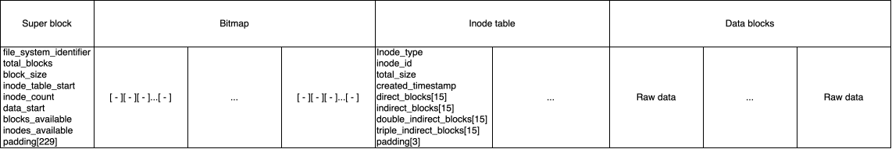

# Diseño de sistema de archivos

## Descripción general

El sistema de archivos _ez-filesystem_ consiste en utilizar un archivo
contenedor el cual sirve para almacenar todos los archivos que se quiera.
El archivo se llama "ez_container.bin". El archivo está segmentado en bloques de
256 bytes cada uno. Dentro de él, al inicio tendrá un super bloque, con
encabezados acerca de información del contenedor entero. Luego del bloque de
meta-datos, sigue una serie de bloques llamados _Bitmaps_ que especificarán los
bloques ocupados en el archivo. Estos bloques ocupados incluyen los bloques de
encabezados. Después, siguen una serie de bloques índice (inode), los cuales son
los identificadores de los archivos y directorios que están guardados en el
contenedor. Finalmente, sigue la serie de bloques de datos. Con la creación
y destrucción de archivos, estos bloques pueden parecer fragmentados, por lo que
entonces, los bloques índice deberán contabilizar sus propios bloques ante
la eventual fragmentación.

El tamaño mínimo del disco es ```x >= 1024``` _bytes_, sin embargo un tamaño
así es impractico. El tamaño máximo que se le puede dar es de __~1.099 TB__.
Pero, cada archivo tendrá un tamaño máximo de __~1.0226 GB__. Lo recomendado es
elegir un tamaño que cumpla las restricciones anteriores y sea divisible
por __256 bytes__

## Forma del contenedor

La siguiente figura ilustra la forma en que el contenedor está conformado.



## Super bloque

### __file_system_identifier__

| Tamaño: 1 _byte_ | Es igual a ```0xC4```. Identifica el formato.

### __total_blocks__

| Tamaño: 4 _bytes_ | Cantidad total de bloques. Mìnimo ```4```.
Máximo: ```4,294,967,295```.

### __block_size__

| Tamaño: 2 _bytes_ | Es igual a ```256```.

### __inode_table_start__

| Tamaño: 4  _bytes_ | _Offset_ igual a ```1 + (cantidad de bloques Bitmap)```.

### __total_inodes__

| Tamaño: 4 _bytes_ | Cantidad de bloques índice creados. Mínimo: ```1```.
Máximo: ```536,870,912```. La cantidad de bloques índice se calcula con la
relación:

```1 inode : 8 bloques de datos```

### __data_start__

| Tamaño: 4 _bytes_ | _Offset_ igual a
```1 + (cantidad de bloques _Bitmap_) + (cantidad de bloques índice)```.

### __blocks_available__

| Tamaño: 4 _bytes_ | Cantidad de bloques de datos libres.
```total_blocks - data_start```. Este atributo es correcto al momento de
formatear el contenedor. Se decrementa al crear un archivo y se incrementa al
borrarlo.

### __inodes_available__

| Tamaño: 4 _bytes_ | Cantidad de bloques índice que se pueden crear.
```data_start - inode_table_start - inode_count - 1```. Este atributo es
correcto al momento de formatear el contenedor. Se decrementa al crear un
archivo y se incrementa al borrarlo.

### __padding__

| Tamaño: 4 _bytes_ | Espacio vacio de relleno para completar el bloque de 256
bytes.

## Bloques _Bitmap_

Este tipo de bloque se usa para contabilizar cuáles bloques ya se han usado, y
cuáles aún no. Si el valor de una casilla es ```1```, entonces
el bloque con correspondiente al índice está en uso. Si es ```0```, está
disponible.

La mínima cantidad de bloques de este tipo es ```ceil( x / 2048 bytes )```,
donde ```x``` corresponde al tamaño total del disco o cantidad total de bloques.
Si el tamaño hace que haya relleno, entonces esas casillas siempre tendrán
almacenado el valor de ```0```. El máximo de bloques _Bitmap_ es
```2,097,152```.

## Tabla de bloques índice

Esta tabla, o mejor dicho, serie de bloques índice siempre tendrá al menos
un bloque _root_, pero puede extenderse a tener ```536,870,912``` bloques
consecutivos. Este bloque especifica las direcciones donde se alojan los datos
de un archivo. También pueden ser de tipo __directorio__, y tener una tabla con
redireccionamientos. Si es de tipo directorio, sus campos de indirección
apuntan a bloques que contienen tablas con nombres e identificadores de otros
bloques índice.

## Bloque índice

Cada bloque índice o _inode_ representa un archivo o directorio dentro del
contenedor. Ocupa exactamente __256 bytes__. El valor ```0x0``` en
cualquier índice/puntero indica que no está en uso.

### __inode_type__

| Tamaño: 1 _byte_ | Tipo del bloque índice. ```0x01 = archivo```,
```0x02 = directorio```.

### __inode_id__

| Tamaño: 4 _bytes_ | Identificador único del bloque índice. Máximo:
```536,870,912```. El identificador del bloque índice _root_ es ```0x0```.

### __total_size__

| Tamaño: 4 _bytes_ | Tamaño total del archivo en bytes. ```0``` si es
directorio. Máximo: __~1.0226 GB__ (```1.0226112e+18 bytes```).

### __created_timestamp__

| Tamaño: 4 _bytes_ | Fecha de creación en formato _Unix timestamp_.

### __direct_blocks__

| Tamaño: 60 _bytes_ | Arreglo de ```15``` índices ```uint32_t``` a bloques de
datos. Capacidad: ```15 × 256 = 3,840 bytes```.

### __indirect_blocks__

| Tamaño: 60 _bytes_ | Arreglo de ```15``` índices ```uint32_t``` a bloques
índice de primer nivel. Cada bloque con índices contiene 64 índices a bloques de
datos. Capacidad: ```15 × 64 × 256 = 245,760 bytes```.

### __double_indirect_blocks__

| Tamaño: 60 _bytes_ | Arreglo de ```15``` índices ```uint32_t``` a bloques
índice de segundo nivel. Cada bloque con índices contiene a 64 bloques índice de
primer nivel. Capacidad: ```15 × 64^2 × 256 = 15,728,640 bytes```.

### __triple_indirect_blocks__

| Tamaño: 60 _bytes_ | Arreglo de ```15``` índices ```uint32_t``` a bloques
índice de tercer nivel. Cada bloque con índices contiene a 64 bloques índice de
segundo nivel. Capacidad: ```15 × 64^3 × 256 = 1,006,632,960 bytes```.

### __padding__

| Tamaño: 3 _bytes_ | Relleno para alcanzar exactamente ```256``` bytes.
Siempre ```0x00```.

## Contenido de bloque de datos de directorio

Cuando un bloque índice es de tipo ```0x02```, el contenido de sus bloques
de datos tiene las siguientes entradas.

### __entry_name__

| Tamaño: 20 _bytes_ | Nombre del archivo o directorio. Terminado en ```0x00```.
El máximo nombre de archivo es de ```19``` caracteres.

### __entry_inode_id__

| Tamaño: 4 _bytes_ | Identificador del bloque índice al que pertenece.
```0x0``` indica entrada vacía.

Cada entrada ocupa ```24``` _bytes_, por lo que caben ```10``` entradas por
bloque de datos (```256 / 24 = 10```).

### __padding__

| Tamaño: 16 _bytes_ | Relleno para alcanzar exactamente ```256``` bytes.
Siempre es igual a ```0x00```.

## Contenido de bloques de datos

Los bloques de datos contienen _bytes_ crudos de datos. Pueden tener
contenido de tamaño variable ```<= 256```. Sin embargo, los _bytes_ no usados,
no se requiren que tengan un valor específico.

## Inodo _root_

Cuando se crea el archivo del sistema de archivos, el primer inodo debe corresponder al directorio _root_. Este directorio es el inodo inicial donde se almacenan todos los demás archivos y directorios de manera recursiva.

## Estructure comun de directorio

Cada directorio en el sistema de archivos tendrá reservados 2 campos en la tabla de entradas a otros inodos. Estos son `.` y `..`. La entrada `.` corresponde al directorio actual y la entrada `..` corresponde al directorio anterior. Esto es para poder navegar a través de los directorios existentes. La única excepción a esta regla es el directorio root. Este solo tendrá el campo `.`, porque antes que el root no hay nada.
